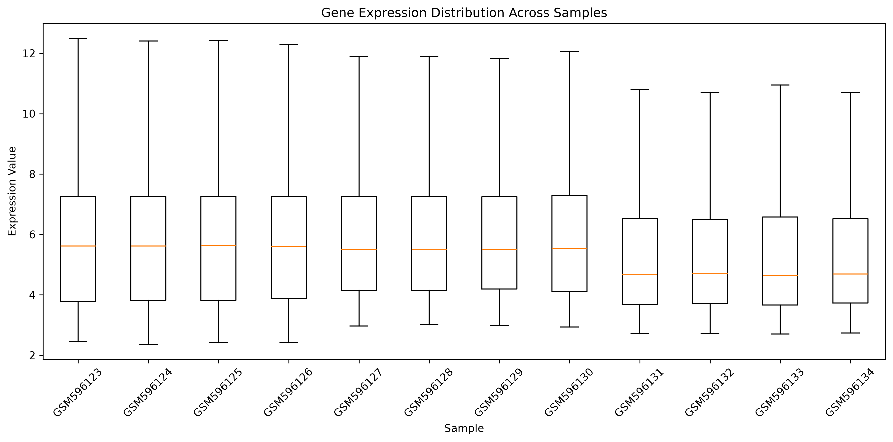
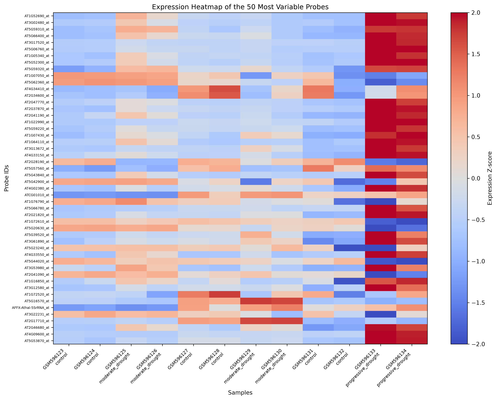
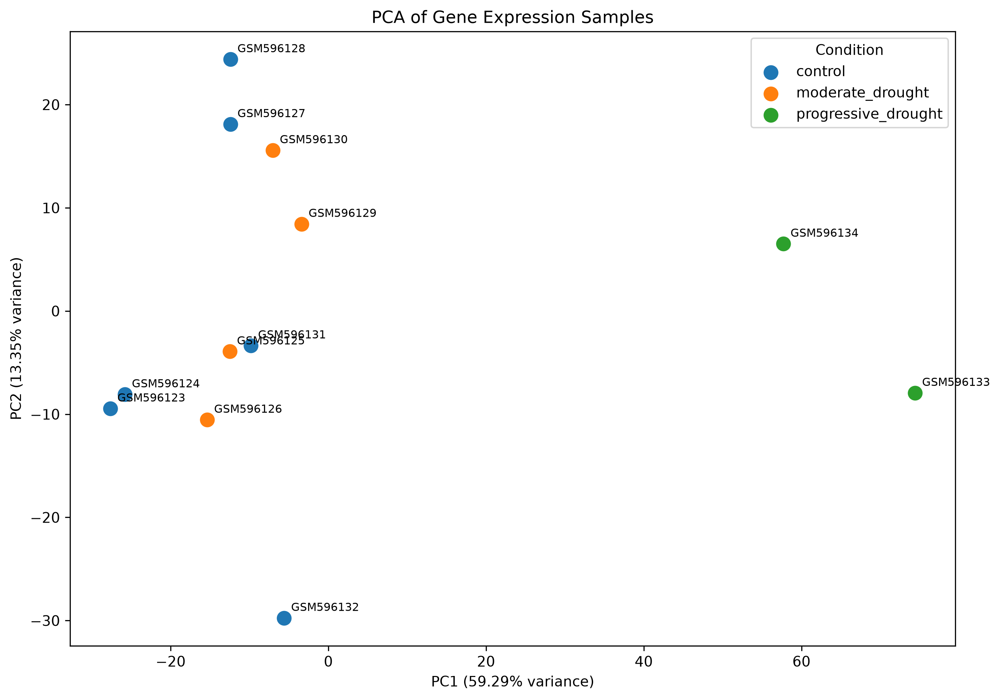
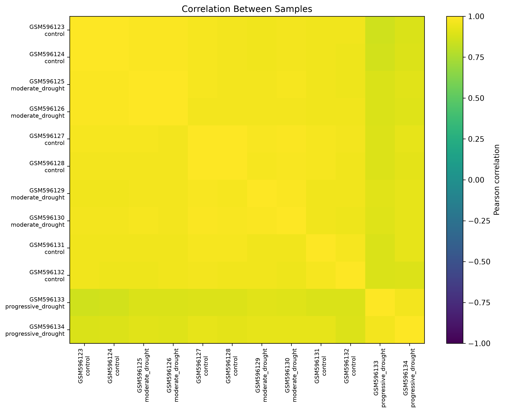
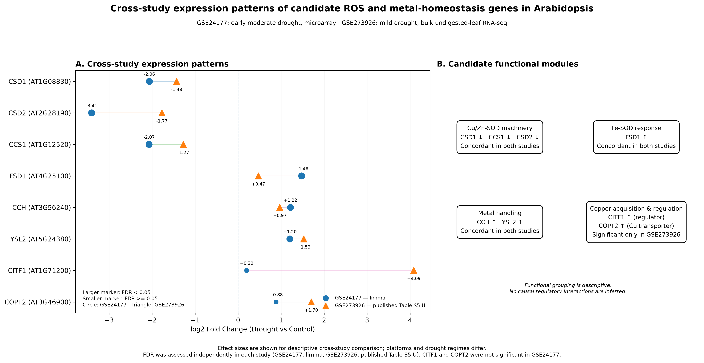
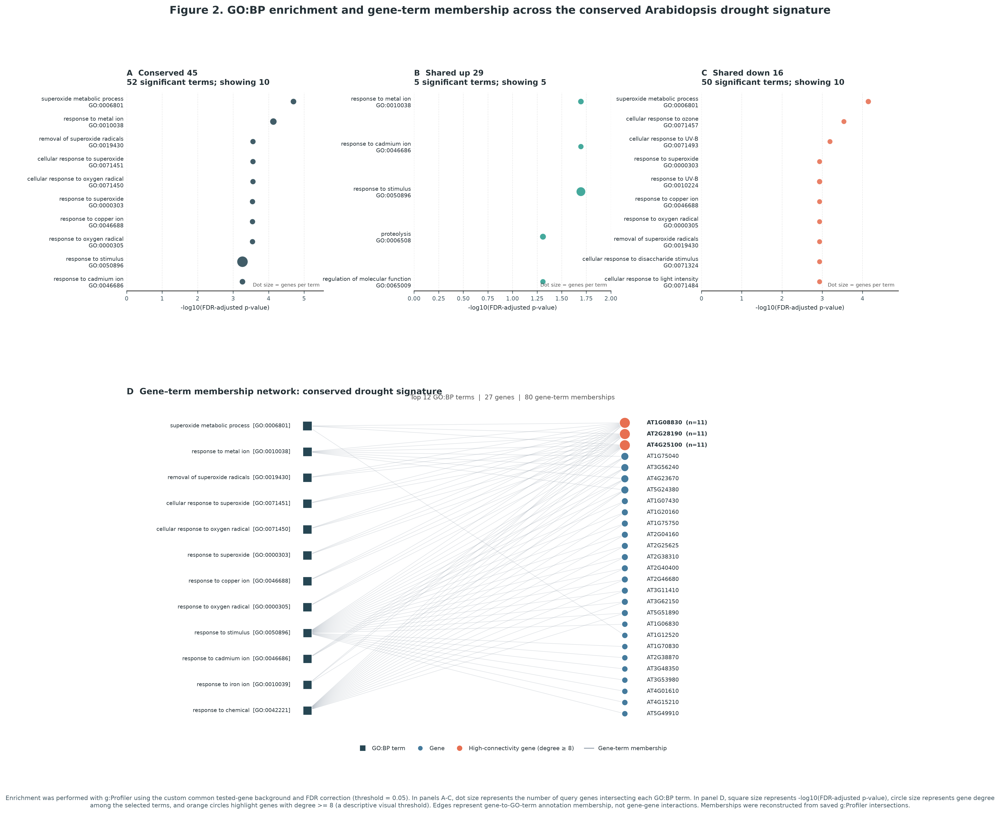

# Gene Expression Explorer 🧬

**A Reproducible Bioinformatics Research Project for Exploring Drought-Responsive Gene Expression in *Arabidopsis thaliana*.**

Gene Expression Explorer is a Python- and R-based bioinformatics project focused on analyzing transcriptomic data, investigating plant responses to environmental stress, and identifying drought-responsive genes through statistical and computational analysis.

The project combines data science, computational biology, statistical bioinformatics, and reproducible software engineering.

Its long-term vision is to evolve into an extensible bioinformatics and AI research platform integrating differential expression analysis, cross-study validation, functional genomics, biological networks, machine learning, and explainable artificial intelligence.

---

## Table of Contents

- [Project Overview](#project-overview)
- [Research Datasets](#research-datasets)
- [Key Features](#key-features)
- [GSE24177: Microarray Analysis](#gse24177-microarray-analysis)
- [GSE273926: Bulk RNA-seq Analysis](#gse273926-bulk-rna-seq-analysis)
- [Cross-study Analysis](#cross-study-analysis)
- [Functional Enrichment and Biological Investigation](#functional-enrichment-and-biological-investigation)
- [Visualization Gallery](#visualization-gallery)
- [Project Structure](#project-structure)
- [Technologies and Dependencies](#technologies-and-dependencies)
- [Installation](#installation)
- [Running the Analysis](#running-the-analysis)
- [Running Tests](#running-tests)
- [Reproducibility and Scientific Limitations](#reproducibility-and-scientific-limitations)
- [Development Roadmap](#development-roadmap)
- [Scientific References](#scientific-references)

---

## Project Overview

The project investigates molecular responses of *Arabidopsis thaliana* to drought stress using publicly available transcriptomic datasets from the NCBI Gene Expression Omnibus (GEO).

Two independent datasets are currently integrated:

| Property | GSE24177 | GSE273926 |
|---|---|---|
| Organism | *Arabidopsis thaliana* | *Arabidopsis thaliana* |
| Data type | Microarray | Bulk RNA-seq |
| GEO platform | GPL10948 | GPL28290 |
| Main analysis | Limma differential expression | Published differential expression results |
| Project role | Initial drought-response study | Independent cross-study comparison |

The two studies provide complementary evidence for investigating drought-responsive gene expression.

The project follows a staged development approach:

1. Data acquisition and preparation.
2. Quality control and exploratory analysis.
3. Differential expression analysis.
4. Gene annotation and identifier harmonization.
5. Cross-study comparison and statistical validation.
6. Functional enrichment and biological interpretation.
7. Machine learning and explainable AI.
8. Interactive scientific visualization.

## Research Datasets

### Dataset 1: GSE24177

**GEO accession:** [GSE24177 - NCBI GEO](https://www.ncbi.nlm.nih.gov/geo/query/acc.cgi?acc=GSE24177)

| Property | Description |
|---|---|
| Organism | *Arabidopsis thaliana* |
| Platform | GPL10948 |
| Technology | Microarray |
| Research focus | Drought stress response |
| Analysis framework | Bioconductor limma |
| Total samples in the study | 12 |

The initial analysis focuses on the early response to moderate drought stress at Day 1.

| Experimental Group | GEO Sample IDs | Biological Replicates |
|---|---|---:|
| Well-watered control | GSM596123, GSM596124 | 2 |
| Moderate drought | GSM596125, GSM596126 | 2 |

The Day 1 comparison is used for the initial differential expression analysis.

### Dataset 2: GSE273926

**GEO accession:** [GSE273926 - NCBI GEO](https://www.ncbi.nlm.nih.gov/geo/query/acc.cgi?acc=GSE273926)

| Property | Description |
|---|---|
| Organism | *Arabidopsis thaliana* |
| Platform | GPL28290 |
| Technology | Bulk RNA-seq |
| Sequencing platform | DNBSEQ-G400 |
| Total GEO samples | 14 |
| Primary comparison | Well-watered vs. mild drought |
| Primary samples | 6 |
| Biological replicates per group | 3 |

The primary cross-study comparison uses the three well-watered and three mild-drought undigested leaf samples:

| Condition | GEO Sample IDs | Replicates |
|---|---|---:|
| Well-watered, undigested | GSM8439682–GSM8439684 | 3 |
| Mild drought, undigested | GSM8439685–GSM8439687 | 3 |

The project preserves the distinction between undigested, digested, and fixed-digested sample groups.

**Important distinction:** Although the associated research article investigates single-cell transcriptomics, GSE273926 contains bulk RNA-seq data. The associated single-cell dataset is deposited separately under [GSE273033](https://www.ncbi.nlm.nih.gov/geo/query/acc.cgi?acc=GSE273033).

The project uses published normalized expression data and supplementary differential expression results. It does not independently rerun a count-based differential expression analysis using normalized expression values.

---

## Key Features

### Data Processing

- Import and process gene expression data.
- Parse GEO series matrix and platform annotation files.
- Prepare structured expression matrices.
- Process supplementary Excel datasets.
- Extract and organize sample metadata.
- Validate gene identifiers and expression values.
- Extract and validate published supplementary expression and differential expression tables.
- Preserve source data and dataset provenance.

### Exploratory Data Analysis

- Analyze gene expression distributions.
- Calculate descriptive statistics.
- Investigate sample-level expression patterns.
- Perform Principal Component Analysis (PCA).
- Generate sample correlation matrices.
- Visualize gene expression profiles.
- Investigate potential batch and experimental effects.

### Differential Expression Analysis

- Perform differential expression analysis using the Bioconductor `limma` package.
- Estimate expression differences between experimental conditions.
- Calculate moderated statistical significance.
- Apply Benjamini-Hochberg multiple testing correction.
- Identify upregulated and downregulated probes.
- Annotate probes with gene identifiers and descriptions.

### Cross-study Validation

- Harmonize gene identifiers across independent datasets.
- Construct a common identifier-compatible gene universe.
- Identify shared significant genes.
- Compare differential expression directions.
- Identify conserved and discordant drought-responsive genes.
- Calculate expected and observed gene overlap.
- Perform hypergeometric and Fisher exact tests.
- Generate reproducible cross-study result tables.

### Log2 Fold Change Reconstruction

- Reconstruct published log2 fold changes from normalized expression values.
- Compare two independent estimation methods.
- Calculate Pearson and Spearman correlations.
- Evaluate MAE, RMSE, and mean bias.
- Validate directional agreement.
- Handle exact zero-valued estimates explicitly as unresolved.

### Functional Enrichment

- Perform Gene Ontology Biological Process (GO:BP) enrichment.
- Use the g:Profiler service for functional annotation.
- Save enrichment response data and generated enrichment tables.
- Investigate ROS-related and metal-homeostasis processes.
- Extract and validate gene-to-term membership from saved enrichment responses.

The GO term-to-gene membership extraction workflow is implemented and validated. It reconstructs membership from the saved g:Profiler responses, checks the extracted records against the source data, and provides the input for the gene-term network visualization.

### Visualization and Reporting

- Generate expression distribution plots.
- Create expression heatmaps.
- Visualize mean expression levels.
- Generate PCA plots.
- Visualize sample correlations.
- Plot differentially expressed genes.
- Generate cross-study expression comparison figures.
- Visualize selected GO:BP terms and their associated genes.
- Export analysis results as CSV files.
- Preserve vector graphics in SVG format.

---

## GSE24177: Microarray Analysis

The first study investigates the early molecular response of *Arabidopsis thaliana* to moderate drought stress.

Differential expression analysis is performed using the Bioconductor `limma` package.

### Analysis Results

The early drought comparison produced the following results:

| Analysis Metric | Result |
|---|---:|
| Total analyzed probes | 21,461 |
| Significant probes (Adjusted P-value < 0.05) | 192 |
| Upregulated probes | 108 |
| Downregulated probes | 84 |
| Probes with mapped gene identifiers | 21,389 |

The analysis uses a drought-versus-control contrast.

Positive log fold change values represent higher expression under drought conditions, while negative values represent lower expression.

The main output files are:

- `results/limma_early_drought_results.csv`
- `results/limma_early_drought_annotated.csv`

### Exploratory PCA

The original exploratory PCA analysis explains:

| Principal Component | Explained Variance |
|---|---:|
| PC1 | 59.29% |
| PC2 | 13.35% |
| Combined | 72.64% |

These values describe the exploratory dataset analysis and should not be interpreted as evidence of a biological mechanism.

---

## GSE273926: Bulk RNA-seq Analysis

The second study introduces an independent bulk RNA-seq dataset for validating drought-associated expression patterns.

### Data Preparation and Quality Control

The preparation workflow extracts the published expression data, organizes sample information, and validates expression identifiers.

The full expression matrix contains:

- 32,833 gene entries.
- 14 GEO samples.
- Three experimental sample types: undigested, digested, and fixed-digested.

The primary undigested comparison contains:

- 3 well-watered control samples.
- 3 mild-drought samples.

The primary comparison uses the undigested samples to support a more consistent comparison with the first dataset.

### Published Differential Expression Results

The project extracts the undigested sample results from the article's Supplementary Table S5.

The published table provides:

- Gene identifiers.
- Base mean expression.
- Log2 fold change.
- Log fold change standard error.
- Test statistics.
- P-values.
- Adjusted P-values.

The published U comparison contains 701 significant gene entries at an adjusted P-value threshold of 0.05.

These are published differential expression results, not results independently generated by this project.

### Supplementary Tables S4/S5 Extraction

The supplementary extraction workflow is implemented in:

`src/extract_gse273926_supplementary.py`

It extracts and validates the published supplementary tables:

| Supplementary Table | Description | Records |
|---|---|---:|
| Table S4 | Normalized expression values | 32,833 genes |
| Table S5 - U | Undigested samples | 701 genes |
| Table S5 - D | Digested samples | 2,990 genes |
| Table S5 - FD | Fixed-digested samples | 286 genes |

Additional validation includes:

- One-to-one mapping of all 14 Table S4 sample columns to GEO sample identifiers.
- Validation of all 32,833 leaf-transcriptome membership records.
- Validation of gene identifiers and expression values.
- Verification of supplementary workbook structure and expected records.
- Comparison of reconstructed Table S5 outputs against previously saved CSV files.

Run the script in dry-run mode:

```bash
python src/extract_gse273926_supplementary.py
```

Save the extracted outputs after successful validation:

```bash
python src/extract_gse273926_supplementary.py --write
```

### Published and Reconstructed Log2FC Validation

The project includes a reproducible workflow for comparing published Table S5 log2 fold changes against estimates reconstructed from Table S4.

The implementation is available in:

`src/validate_log2fc_estimators.py`

Two independent estimators are reconstructed using a pseudocount of one.

**Method 1 - Ratio of group means**

```text
log2((mean(mild_drought) + 1) / (mean(well_watered) + 1))
```

**Method 2 - Mean of log2-transformed sample values**

```text
mean(log2(mild_drought + 1)) - mean(log2(well_watered + 1))
```

The validation workflow calculates:

- Pearson correlation.
- Spearman correlation.
- Mean Absolute Error (MAE).
- Root Mean Squared Error (RMSE).
- Mean bias.
- Directional agreement.

The published comparisons include the following numbers of genes with available matching published and reconstructed estimates:

- 701 genes in the U group.
- 176 genes in the D group.
- 124 genes in the FD group.

These are the comparison counts for the estimator-validation workflow; they are not the total numbers of records in the extracted Table S5 D and FD files.

#### Reconstruction Results

| Group | Method | Genes | Pearson r | Spearman rho | MAE | RMSE | Mean Bias |
|---|---:|---:|---:|---:|---:|---:|---:|
| U | 1 | 701 | 0.994606 | 0.999039 | 0.077075 | 0.136760 | 0.059633 |
| U | 2 | 701 | 0.994135 | 0.999852 | 0.067485 | 0.135493 | 0.052846 |
| D | 1 | 176 | 0.995967 | 0.986837 | 0.169289 | 0.190770 | -0.153813 |
| D | 2 | 176 | 0.999906 | 0.999919 | 0.142299 | 0.143393 | -0.142299 |
| FD | 1 | 124 | 0.996904 | 0.991471 | 0.054943 | 0.088606 | 0.024802 |
| FD | 2 | 124 | 0.999931 | 0.999893 | 0.029768 | 0.030918 | 0.028180 |

All six published-versus-reconstructed comparisons showed 100% directional agreement among resolved gene pairs.

#### Directional Reconstruction Across the 701 Published U Genes

The following is a separate cross-group direction summary for the 701-gene U reference set. It should not be confused with the six within-group estimator-validation comparisons above.

| Comparison | Same Direction | Opposite Direction | Unresolved |
|---|---:|---:|---:|
| U | 701 | 0 | 0 |
| D S4 estimator | 505 | 196 | 0 |
| FD S4 estimator | 661 | 39 | 1 |

Exact zero log2FC values are classified as `zero`. Comparisons involving zero are treated as `unresolved`, rather than automatically assigning the gene to the upregulated or downregulated category.

This distinction is relevant to gene `AT2G16740`, whose FD S4 estimator is exactly zero.

These estimates are descriptive reconstructions from published normalized expression values. They do not replace the original published differential expression results.

Run the workflow in dry-run mode:

```bash
python src/validate_log2fc_estimators.py
```

Save reconstructed outputs after successful comparison:

```bash
python src/validate_log2fc_estimators.py --write
```

The script permits only the documented zero-direction corrections. Unexpected differences in existing output files prevent write-mode execution.

---

## Cross-study Analysis

The cross-study workflow compares drought-responsive genes identified in the two independent studies.

The analysis is implemented in:

`src/cross_study_analysis.py`

### Methodology

The workflow performs the following steps:

1. Loads GSE24177 annotated Limma results.
2. Loads GSE273926 expression gene identifiers.
3. Loads the published GSE273926 U-group differential expression table.
4. Constructs a common identifier-compatible gene universe.
5. Selects significant results using an adjusted P-value threshold of 0.05.
6. Identifies shared significant genes.
7. Compares differential expression directions.
8. Performs statistical overlap validation.
9. Generates reproducible CSV outputs.
10. Compares reconstructed outputs with previously saved result files.

### Common Gene Identifier Universe

The current operational universe is defined as the intersection of:

- Gene identifiers in the GSE273926 expression matrix.
- Nonblank gene identifiers in the GSE24177 Limma results.

The resulting universe contains 20,409 unique gene identifiers.

**Important methodological limitation:** This is an identifier-compatible comparison universe. It has not yet been independently confirmed as the complete set of genes tested by both studies.

The published GSE273926 Table S5 is a prefiltered DEG table rather than a complete differential expression result table. Therefore, the overlap statistics are conditional on the current universe definition.

The expression identifier audit also confirmed that chloroplast identifiers such as `ATCG...` must be retained. A restrictive regular expression that only accepts identifiers matching `AT1G` through `AT5G` would incorrectly exclude valid genes.

### Reconstructed Cross-study Results

| Metric | Result |
|---|---:|
| Common identifier universe | 20,409 |
| Significant GSE24177 results | 192 |
| Published GSE273926 U DEG entries | 701 |
| GSE273926 genes inside the common universe | 607 |
| GSE273926 genes outside the common universe | 94 |
| Shared significant genes | 52 |
| Same-direction shared genes | 45 |
| Opposite-direction shared genes | 7 |
| Unresolved direction | 0 |
| Same-direction percentage | 86.54% |

The 94 GSE273926 genes outside the common universe are present in the expression matrix but do not have matching annotated gene identifiers in the GSE24177 Limma results. They are not necessarily invalid genes; they are excluded from this particular cross-study comparison.

Only the 607 GSE273926 U genes inside the operational common universe are used as the GSE273926 significant set in the overlap calculation. The 701 published U entries must not be substituted directly for that 607-gene set.

### Directional Agreement

The 52 shared genes are classified as follows:

| Directional Category | Number of Genes |
|---|---:|
| Upregulated in both studies | 29 |
| Downregulated in both studies | 16 |
| Opposite directions | 7 |
| Unresolved | 0 |
| Total | 52 |

### Statistical Validation

The analysis calculates expected overlap and fold enrichment within the operational common identifier universe.

| Statistic | Result |
|---|---:|
| Expected overlap | 5.710422 |
| Observed overlap | 52 |
| Fold enrichment | 9.106157 |
| Hypergeometric p-value | 3.373684e-35 |
| Overlap Fisher odds ratio | 13.15861 |
| Overlap Fisher p-value | 3.373684e-35 |
| Direction Fisher odds ratio | 46.4 |
| Direction Fisher p-value | 2.261238e-07 |

These statistical results describe the observed overlap under the current identifier-universe definition. They do not establish causality and should not be described as a formal effect-size meta-analysis.

### Generated Cross-study Outputs

All outputs are saved under:

`results/cross_study/`

| File | Description |
|---|---|
| `common_tested_gene_universe.csv` | Operational common identifier universe |
| `cross_study_overlap_summary.csv` | Overlap and directional summary |
| `cross_study_statistical_validation.csv` | Statistical validation results |
| `significant_drought_genes_shared.csv` | All 52 shared significant genes |
| `conserved_drought_signature_45_genes.csv` | 45 same-direction genes |
| `shared_upregulated_drought_genes_29.csv` | 29 upregulated genes |
| `shared_downregulated_drought_genes_16.csv` | 16 downregulated genes |
| `discordant_drought_genes_7.csv` | 7 opposite-direction genes |

The workflow validates reconstructed outputs against existing CSV files before allowing write-mode execution.

Detailed methodology is documented in `docs/CROSS_STUDY_ANALYSIS.md`.

---

## Functional Enrichment and Biological Investigation

The project performs Gene Ontology Biological Process enrichment using g:Profiler.

The analysis investigates biological processes associated with conserved and direction-specific drought-responsive gene sets.

Current saved enrichment outputs include results for:

- Conserved shared drought-responsive genes.
- Shared upregulated genes.
- Shared downregulated genes.

The project also investigates candidate biological themes involving:

- Reactive oxygen species (ROS) metabolism.
- Copper homeostasis.
- Superoxide dismutase-related genes.
- Metal transport and regulation.
- Stress-associated transcriptional responses.

### Exploratory Biological Interpretation

An exploratory candidate signature suggests changes in the expression patterns of selected ROS-related and metal-homeostasis genes across both studies.

Examples include:

- CSD1 (`AT1G08830`)
- CSD2 (`AT2G28190`)
- CCS1 (`AT1G12520`)
- FSD1 (`AT4G25100`)
- CCH (`AT3G56240`)
- YSL2 (`AT5G24380`)

These observations motivate further investigation of ROS metabolism and metal homeostasis during drought stress.

They do not independently demonstrate copper deficiency, altered enzyme activity, or changes in ROS concentrations.

The project includes reproducible workflows for generating the curated ROS/metal candidate table and copper-homeostasis comparison tables:

- `src/build_ros_metal_gene_table.py`
- `src/build_copper_homeostasis_tables.py`

The copper-homeostasis analysis includes a curated 15-gene candidate panel. Its sample-level output preserves expression values from the six primary undigested samples.

An additional exploratory investigation considers SPL7 (`AT5G18830`) as a potential regulatory candidate. Its current interpretation is documented in `docs/MANUAL_WORKFLOW_INVENTORY.md`; a standalone reproducible SPL7 analysis script remains a future task.

The current enrichment responses, tables, and exploratory biological outputs are saved under:

`results/cross_study/GO_enrichment/`

### GO Term-to-Gene Membership

The GO term-to-gene membership table is reconstructed from saved g:Profiler JSON responses by:

`src/extract_go_term_membership.py`

Its validation workflow compares 358 reconstructed records against 358 existing records, with no missing rows, extra rows, or changed adjusted p-values.

The validated membership table is used by:

`src/plot_go_bp_figure.py`

This workflow provides the input for Figure 2, which visualizes selected GO:BP terms and their member genes.

---

## Visualization Gallery

The project generates exploratory figures for gene expression, sample relationships, and cross-study biological comparisons.

### GSE24177 Exploratory Analysis

**Expression Distribution**



**Expression Heatmap**



**Principal Component Analysis**



**Sample Correlation**



Additional expression visualizations are saved in `results/figures/`.

### GSE273926 Exploratory Analysis

The GSE273926 quality-control and sample-level visualizations are saved under:

`results/GSE273926/figures/`

These include:

- Expression distribution.
- Expression heatmap.
- PCA by sample and experimental condition.
- Sample correlation.

### Cross-study Biological Comparison

**Exploratory Figure 1: ROS and Metal-homeostasis Drought Signature**



The figure compares selected candidate genes across GSE24177 and GSE273926.

It is an exploratory visualization, not a final publication figure.

**Figure 2: GO:BP Functional Enrichment and Gene-to-Term Network**



Figure 2 combines enrichment summaries for the conserved, shared upregulated, and shared downregulated gene sets with a network showing selected GO:BP terms and their member genes.

The selected network contains 12 GO:BP terms, 27 genes, and 80 term-to-gene membership edges. These edges represent gene membership in GO terms; they do not represent physical or regulatory gene-to-gene interactions.

PNG and SVG outputs are saved under:

`results/cross_study/GO_enrichment/figures/`

---

## Project Structure

The following tree shows the main project organization and selected important files. Some generated result files and intermediate outputs are omitted for readability.

```text
gene-expression-explorer/
│
├── data/
│   ├── metadata/
│   │   ├── GSE273926_all_RunInfo.csv
│   │   ├── GSE273926_GEO_SRA_mapping.csv
│   │   ├── GSE273926_leaf_transcriptome_membership.csv
│   │   ├── GSE273926_sample_metadata.csv
│   │   ├── GSE273926_selected_RunInfo.csv
│   │   ├── GSE273926_selected_undigested_RunInfo.csv
│   │   ├── GSE273926_sra_records.xml
│   │   ├── GSE273926_sra_search.json
│   │   ├── PMC11982798_s3_listing.xml
│   │   └── sample_metadata.csv
│   │
│   ├── processed/
│   │   ├── GSE24177_expression.csv
│   │   └── GSE273926/
│   │       ├── GSE273926_normalized_counts_all_samples.csv
│   │       └── GSE273926_normalized_counts_undigested.csv
│   │
│   ├── raw/
│   │   ├── GSE24177_series_matrix.txt.gz
│   │   └── GPL10948_family.soft.gz
│   │
│   ├── supplementary/
│   │   └── GSE273926/
│   │       ├── GSE273926_TenorioBerrio_2024_processed.xlsx
│   │       ├── NPH-246-840-s001.xlsx
│   │       └── NPH-246-840-s010.xlsx
│   │
│   └── README.md
│
├── docs/
│   ├── CROSS_STUDY_ANALYSIS.md
│   ├── MANUAL_WORKFLOW_INVENTORY.md
│   └── ROADMAP.md
│
├── results/
│   ├── cross_study/
│   │   ├── GO_enrichment/
│   │   │   ├── figures/
│   │   │   │   ├── figure1_copper_ros_drought_signature.png
│   │   │   │   ├── figure1_copper_ros_drought_signature.svg
│   │   │   │   ├── figure2_go_bp_enrichment_gene_term_network.png
│   │   │   │   └── figure2_go_bp_enrichment_gene_term_network.svg
│   │   │   ├── conserved_45_GO_BP_enrichment.csv
│   │   │   ├── conserved_45_GO_BP_response.json
│   │   │   ├── copper_homeostasis_regulon_comparison.csv
│   │   │   ├── copper_homeostasis_sample_level.csv
│   │   │   ├── core_ROS_metal_genes.csv
│   │   │   ├── GO_BP_gene_input_validation.csv
│   │   │   ├── GO_BP_run_summary.csv
│   │   │   ├── GO_BP_term_gene_membership.csv
│   │   │   ├── shared_down_16_GO_BP_enrichment.csv
│   │   │   ├── shared_down_16_GO_BP_response.json
│   │   │   ├── shared_up_29_GO_BP_enrichment.csv
│   │   │   └── shared_up_29_GO_BP_response.json
│   │   │
│   │   ├── common_tested_gene_universe.csv
│   │   ├── conserved_drought_signature_45_genes.csv
│   │   ├── cross_study_overlap_summary.csv
│   │   ├── cross_study_statistical_validation.csv
│   │   ├── discordant_drought_genes_7.csv
│   │   ├── shared_downregulated_drought_genes_16.csv
│   │   ├── shared_upregulated_drought_genes_29.csv
│   │   └── significant_drought_genes_shared.csv
│   │
│   ├── figures/
│   │   ├── expression_distribution.png
│   │   ├── expression_heatmap.png
│   │   ├── mean_expression.png
│   │   ├── pca_samples.png
│   │   ├── sample_correlation.png
│   │   └── top_drought_genes.png
│   │
│   ├── GSE273926/
│   │   ├── article_reference/
│   │   │   ├── article_table_s4.csv
│   │   │   ├── article_table_s5_U.csv
│   │   │   ├── article_table_s5_D.csv
│   │   │   ├── article_table_s5_FD.csv
│   │   │   └── log2FC_estimator_validation.csv
│   │   ├── figures/
│   │   ├── GSE273926_log2_normalized_expression.csv
│   │   ├── GSE273926_QC_PCA_summary.md
│   │   ├── pca_coordinates.csv
│   │   ├── pca_group_summary.csv
│   │   └── sample_qc_summary.csv
│   │
│   ├── limma_early_drought_annotated.csv
│   └── limma_early_drought_results.csv
│
├── src/
│   ├── annotate_drought_results.py
│   ├── build_copper_homeostasis_tables.py
│   ├── build_ros_metal_gene_table.py
│   ├── cross_study_analysis.py
│   ├── data_loader.py
│   ├── exploratory_analysis.py
│   ├── exploratory_analysis_gse273926.py
│   ├── extract_go_term_membership.py
│   ├── extract_gse273926_supplementary.py
│   ├── geo_data_loader.py
│   ├── go_enrichment_cross_study.py
│   ├── limma_early_drought.R
│   ├── plot_copper_ros_drought_figure.py
│   ├── plot_drought_results.py
│   ├── plot_go_bp_figure.py
│   ├── prepare_gse273926.py
│   ├── validate_geo_dataset.py
│   └── validate_log2fc_estimators.py
│
├── tests/
│   ├── test_build_copper_homeostasis_tables.py
│   ├── test_build_ros_metal_gene_table.py
│   ├── test_cross_study_analysis.py
│   ├── test_data_loader.py
│   ├── test_extract_go_term_membership.py
│   ├── test_extract_gse273926_supplementary.py
│   ├── test_plot_go_bp_figure.py
│   ├── test_prepare_gse273926.py
│   ├── test_validate_geo_dataset.py
│   └── test_validate_log2fc_estimators.py
│
├── .gitignore
├── install_r_dependencies.R
├── README.md
└── requirements.txt
```

The `data/` directory contains source data, supplementary files, metadata, and processed expression matrices.

The `results/` directory contains analysis outputs, intermediate result tables, and generated figures.

The `src/` directory contains analysis and data-processing scripts, while `tests/` contains automated unit tests.

Large source datasets and supplementary files should retain their original provenance and should not be confused with generated analysis outputs.

---

## Technologies and Dependencies

| Technology | Application |
|---|---|
| Python | Data processing and analysis |
| R | Differential expression analysis |
| NumPy | Numerical computation |
| Pandas | Data manipulation |
| Matplotlib | Scientific visualization |
| Scikit-learn | PCA and future machine learning workflows |
| SciPy | Statistical calculations and hypothesis testing |
| OpenPyXL | Supplementary Excel processing |
| Truststore | SSL certificate handling for external API requests |
| Bioconductor limma | Microarray differential expression analysis |
| g:Profiler | Functional enrichment analysis |
| Git and GitHub | Version control and project development |

Python dependencies are version-pinned in `requirements.txt`.

R dependencies are managed separately through `install_r_dependencies.R`.

### Tested Environment

| Component | Tested Version |
|---|---|
| Python | 3.14.0 |
| NumPy | 2.4.0 |
| Pandas | 3.0.3 |
| Matplotlib | 3.11.0 |
| Scikit-learn | 1.9.0 |
| SciPy | 1.17.1 |
| OpenPyXL | 3.1.5 |
| Truststore | 0.10.5 |
| R | 4.6.2 |
| limma | 3.68.5 |

---

## Installation

### Prerequisites

- Python 3.11 or newer.
- R (tested with R 4.6.2).
- Git.
- Bioconductor `limma` package.
- Internet connection for downloading public datasets and using external enrichment services.

### 1. Clone the Repository

```bash
git clone https://github.com/m-mahdi-arjangi/gene-expression-explorer.git

cd gene-expression-explorer
```

### 2. Create a Python Virtual Environment

```bash
python -m venv .venv
```

Activate the environment on Windows:

```powershell
.\.venv\Scripts\Activate.ps1
```

Activate the environment on Linux or macOS:

```bash
source .venv/bin/activate
```

### 3. Install Python Dependencies

```bash
python -m pip install --upgrade pip

python -m pip install -r requirements.txt
```

Check dependency consistency:

```bash
python -m pip check
```

### 4. Install R Dependencies

On systems where `Rscript` is available in PATH:

```bash
Rscript install_r_dependencies.R
```

On the tested Windows environment, Rscript may be invoked using its full path:

```powershell
& "C:\Program Files\R\R-4.6.2\bin\Rscript.exe" install_r_dependencies.R
```

The installation script uses Bioconductor package management to install the required R dependencies.

---

## Running the Analysis

Run the following commands from the repository root.

### GSE24177 Workflow

**Step 1: Prepare the GEO Dataset**

```bash
python src/geo_data_loader.py
```

**Step 2: Validate the Dataset**

```bash
python src/validate_geo_dataset.py
```

**Step 3: Perform Exploratory Data Analysis**

```bash
python src/exploratory_analysis.py
```

**Step 4: Perform Differential Expression Analysis**

On Windows:

```powershell
& "C:\Program Files\R\R-4.6.2\bin\Rscript.exe" src/limma_early_drought.R
```

On systems where Rscript is available in PATH:

```bash
Rscript src/limma_early_drought.R
```

**Step 5: Annotate Differentially Expressed Probes**

```bash
python src/annotate_drought_results.py
```

**Step 6: Generate Visualizations**

```bash
python src/plot_drought_results.py
```

### GSE273926 Workflow

**Step 1: Prepare the GSE273926 Dataset**

```bash
python src/prepare_gse273926.py
```

**Step 2: Perform Exploratory Analysis**

```bash
python src/exploratory_analysis_gse273926.py
```

The exploratory analysis generates descriptive statistics, quality-control results, and sample-level visualizations.

It should not be interpreted as a replacement for formal differential expression analysis.

**Step 3: Extract and Validate Supplementary Tables**

```bash
python src/extract_gse273926_supplementary.py
```

After reviewing the dry-run comparison, save the outputs:

```bash
python src/extract_gse273926_supplementary.py --write
```

**Step 4: Reconstruct and Validate Log2FC Estimates**

```bash
python src/validate_log2fc_estimators.py
```

After reviewing the existing-output comparison:

```bash
python src/validate_log2fc_estimators.py --write
```

### Cross-study Workflow

**Step 1: Rebuild and Validate Cross-study Results**

```bash
python src/cross_study_analysis.py
```

This runs in dry-run mode by default.

**Step 2: Save Reconstructed Outputs**

After reviewing the comparison:

```bash
python src/cross_study_analysis.py --write
```

Write mode stops if unexpected differences exist in previously saved results.

**Step 3: Generate the ROS/Metal Candidate Table**

```bash
python src/build_ros_metal_gene_table.py
```

This command validates the reconstructed table against the existing output by default.

After reviewing the comparison, save the output:

```bash
python src/build_ros_metal_gene_table.py --write
```

**Step 4: Generate Copper-homeostasis Comparison Tables**

```bash
python src/build_copper_homeostasis_tables.py
```

The default mode validates the existing outputs without modifying them.

After reviewing the comparison, create missing outputs:

```bash
python src/build_copper_homeostasis_tables.py --write
```

Existing mismatched outputs are protected. Use `--force` together with `--write` only when the differences have been reviewed and replacement is intentional.

**Step 5: Perform GO:BP Enrichment**

```bash
python src/go_enrichment_cross_study.py
```

This step requires internet access to communicate with the g:Profiler service.

**Step 6: Generate the Exploratory Cross-study Figure**

```bash
python src/plot_copper_ros_drought_figure.py
```

**Step 7: Reconstruct and Validate GO:BP Gene-to-term Membership**

```bash
python src/extract_go_term_membership.py
```

After reviewing the dry-run comparison, write the validated membership table:

```bash
python src/extract_go_term_membership.py --write
```

**Step 8: Generate Figure 2**

```bash
python src/plot_go_bp_figure.py
```

The GO membership extraction and Figure 2 generation steps use saved enrichment responses and tables. They do not require a new g:Profiler request when those source outputs are already available.

The resulting tables and figures are saved under `results/`.

---

## Running Tests

The project uses Python's built-in `unittest` framework.

To execute the complete unit test suite:

```bash
python -m unittest discover -s tests -v
```

To execute only the cross-study analysis tests:

```bash
python -m unittest discover -s tests -p "test_cross_study_analysis.py" -v
```

To execute only the data loader tests:

```bash
python -m unittest discover -s tests -p "test_data_loader.py" -v
```

To execute only the GSE273926 preparation tests:

```bash
python -m unittest discover -s tests -p "test_prepare_gse273926.py" -v
```

To execute only the GEO dataset validation tests:

```bash
python -m unittest discover -s tests -p "test_validate_geo_dataset.py" -v
```

To execute only the supplementary extraction tests:

```bash
python -m unittest discover -s tests -p "test_extract_gse273926_supplementary.py" -v
```

To execute only the Log2FC validation tests:

```bash
python -m unittest discover -s tests -p "test_validate_log2fc_estimators.py" -v
```

To execute only the GO term-to-gene membership tests:

```bash
python -m unittest discover -s tests -p "test_extract_go_term_membership.py" -v
```

To execute only the Figure 2 plotting tests:

```bash
python -m unittest discover -s tests -p "test_plot_go_bp_figure.py" -v
```

To execute only the ROS/metal gene table tests:

```bash
python -m unittest discover -s tests -p "test_build_ros_metal_gene_table.py" -v
```

To execute only the copper-homeostasis table tests:

```bash
python -m unittest discover -s tests -p "test_build_copper_homeostasis_tables.py" -v
```

To check Python syntax:

```bash
python -m compileall -q src tests
```

To validate dependency consistency:

```bash
python -m pip check
```

### Current Test Coverage

| Test Suite | Number of Tests |
|---|---:|
| Cross-study analysis | 17 |
| Data loader | 5 |
| GSE273926 preparation | 18 |
| GEO dataset validation | 8 |
| Supplementary S4/S5 extraction | 23 |
| Log2FC estimator validation | 35 |
| GO term membership extraction | 12 |
| GO:BP figure generation | 8 |
| ROS/metal gene table generation | 15 |
| Copper-homeostasis table generation | 23 |
| **Total** | **164** |

**All 164 unit tests passed in the latest verified full test run on November 10, 2026.**

The test suite covers:

- Expression data loading and validation.
- GSE273926 data preparation.
- Supplementary S4/S5 extraction and validation.
- GEO sample metadata validation.
- Cross-study statistical calculations.
- Log2FC estimator reconstruction.
- Directional classification and zero-value handling.
- GO term-to-gene membership reconstruction and validation.
- Figure 2 input and output validation.
- ROS/metal and copper-homeostasis table reconstruction.
- Existing-output comparison and unexpected-difference detection.

Synthetic datasets are used where appropriate. The unit tests are designed to run locally without requiring new GEO downloads or network requests.

---

## Reproducibility and Scientific Limitations

Reproducibility and scientific validity are central goals of this project.

The following principles are maintained:

- Original public dataset provenance must be preserved.
- Data preparation and analysis steps should be documented.
- Differential expression thresholds and statistical parameters must be explicit.
- Published differential expression tables must not be treated as complete tested-gene result tables.
- Identifier compatibility must be considered when comparing independent studies.
- Exploratory analysis must not be presented as formal differential expression analysis.
- Normalized expression values must not be used as input for a new count-based differential expression analysis.
- Cross-study overlap must not be confused with formal effect-size meta-analysis.
- Statistical enrichment and expression correlation do not establish causality.
- Machine learning models must be evaluated without study-level data leakage.
- Biological interpretations should be validated using independent datasets.
- Research novelty must be assessed against existing scientific literature.
- Exact zero effect estimates must not be silently assigned to either upregulated or downregulated categories.

The current cross-study identifier universe requires further validation against the complete tested-gene sets from both studies.

The current biological findings are exploratory and should not be presented as experimentally validated mechanisms.

The GO:BP enrichment responses, enrichment tables, and gene-to-term membership table are saved. The membership extraction and Figure 2 generation workflows have dedicated unit tests.

The biological interpretation remains exploratory and depends on the selected gene sets, annotation coverage, and configured background.

---

## Development Roadmap

The project is under active development.

### Phase 1 - Repository Engineering and Reproducibility

- [x] GSE24177 analysis workflow.
- [x] GSE273926 data preparation.
- [x] GSE273926 Supplementary Tables S4/S5 extraction workflow.
- [x] Reconstruct and validate published versus estimated Log2FC outputs.
- [x] Reconstruct directional agreement and explicitly handle zero-valued estimates.
- [x] Cross-study overlap analysis script.
- [x] Reconstruct and validate existing cross-study outputs.
- [x] Recover reproducible ROS/metal candidate table generation.
- [x] Recover reproducible copper-homeostasis table generation.
- [x] Recover and document the exploratory SPL7/regulatory-gene investigation.
- [ ] Implement a standalone reproducible SPL7 analysis script.
- [ ] Complete repository audit and data storage policy.
- [ ] Develop an automated end-to-end analysis pipeline.
- [ ] Add structured logging and error handling.
- [ ] Complete documentation of data provenance and analysis parameters.

### Phase 2 - Software Quality

- [x] Data validation tests.
- [x] Cross-study statistical tests.
- [x] Cross-study output comparison tests.
- [x] Supplementary extraction and validation tests.
- [x] Log2FC estimator and output comparison tests.
- [x] GO term-to-gene membership extraction and validation tests.
- [x] Figure 2 plotting and input-validation tests.
- [x] ROS/metal table generation tests.
- [x] Copper-homeostasis table generation tests.
- [ ] Integration tests.
- [ ] GitHub Actions continuous integration.

Current verified test status:

- **164 unit tests passing.**
- 17 tests cover cross-study analysis.
- 23 tests cover Supplementary S4/S5 extraction.
- 35 tests cover Log2FC estimator reconstruction and validation.
- 12 tests cover GO term-to-gene membership extraction.
- 8 tests cover Figure 2 generation.
- 15 tests cover ROS/metal table generation.
- 23 tests cover copper-homeostasis table generation.

### Phase 3 - Expanded Biological Analysis

- [ ] Integrate additional independent drought datasets.
- [ ] Compare additional tissues and drought conditions.
- [ ] Perform effect-size-based meta-analysis.
- [ ] Evaluate cross-study heterogeneity.
- [ ] Perform sensitivity and robustness analyses.
- [ ] Expand functional and regulatory network analysis.

### Phase 4 - Scientific Figures and Reporting

- [x] Exploratory Figure 1: ROS and metal-homeostasis expression patterns.
- [x] Figure 2: GO:BP functional enrichment visualization.
- [x] Visualize genes contributing to enriched GO terms.
- [ ] Prepare publication-quality figures.
- [ ] Generate reproducible HTML reports.

Figure 2 is complete: GO:BP term-to-gene membership has been reconstructed and validated, and the enrichment visualization and gene-term network have been generated.

### Phase 5 - Machine Learning and Explainable AI

- [ ] Build a sufficiently large multi-study expression dataset.
- [ ] Develop drought-response classification models.
- [ ] Use study-aware validation to prevent data leakage.
- [ ] Evaluate models on independent datasets.
- [ ] Apply feature importance and SHAP.
- [ ] Investigate robust gene signatures.

### Phase 6 - Interactive Web Platform

- [ ] Develop a Python backend using FastAPI.
- [ ] Build an interactive scientific dashboard.
- [ ] Develop the frontend using React and TypeScript.
- [ ] Add dataset and gene search.
- [ ] Visualize expression, enrichment, and network results.
- [ ] Integrate validated machine learning models.
- [ ] Support downloadable analysis reports.

### Phase 7 - Research Validation and Publication

- [ ] Conduct a systematic literature review.
- [ ] Assess research novelty.
- [ ] Validate findings using independent datasets.
- [ ] Identify opportunities for experimental validation.
- [ ] Prepare a scientific manuscript.
- [ ] Evaluate suitable journals.

---

## Scientific References

### Public Datasets

- [GSE24177 - NCBI Gene Expression Omnibus](https://www.ncbi.nlm.nih.gov/geo/query/acc.cgi?acc=GSE24177)
- [GPL10948 - NCBI GEO Platform](https://www.ncbi.nlm.nih.gov/geo/query/acc.cgi?acc=GPL10948)
- [GSE273926 - NCBI Gene Expression Omnibus](https://www.ncbi.nlm.nih.gov/geo/query/acc.cgi?acc=GSE273926)
- [GPL28290 - NCBI GEO Platform](https://www.ncbi.nlm.nih.gov/geo/query/acc.cgi?acc=GPL28290)
- [GSE273033 - Associated single-cell RNA-seq dataset](https://www.ncbi.nlm.nih.gov/geo/query/acc.cgi?acc=GSE273033)

### Analysis Resources

- [limma - Bioconductor](https://bioconductor.org/packages/limma/)
- [g:Profiler](https://biit.cs.ut.ee/gprofiler/)
- [NCBI Gene Expression Omnibus](https://www.ncbi.nlm.nih.gov/geo/)

---

- **Project:** Gene Expression Explorer
- **Focus:** Plant Stress Transcriptomics, Bioinformatics, and AI
- **Organism:** *Arabidopsis thaliana*
- **Repository:** [GitHub - gene-expression-explorer](https://github.com/m-mahdi-arjangi/gene-expression-explorer)